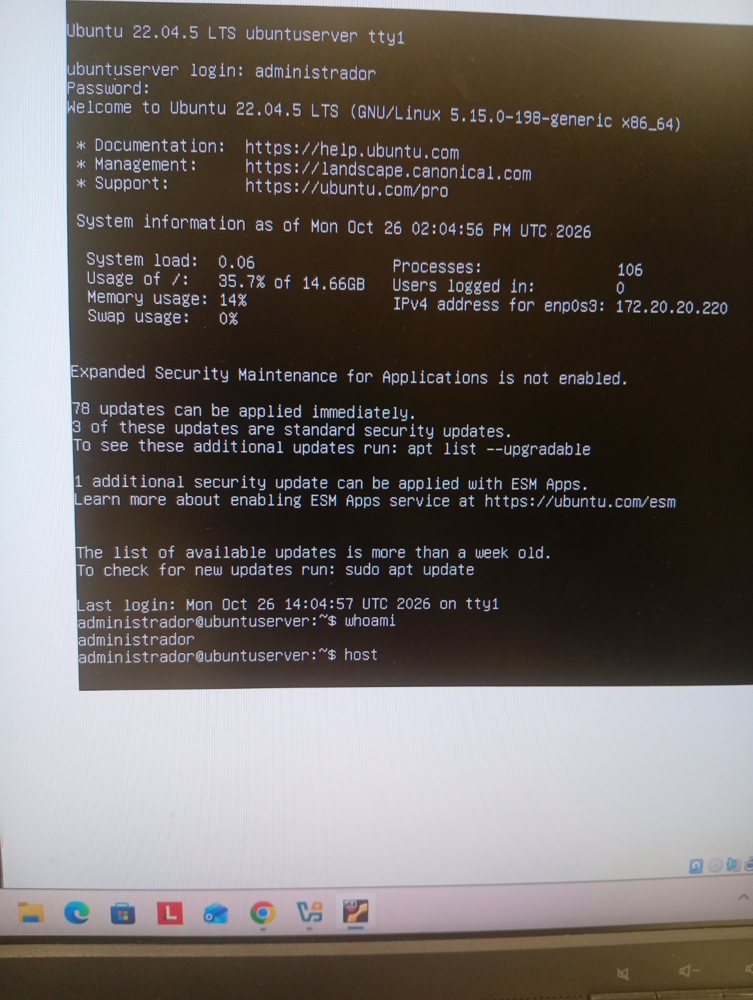
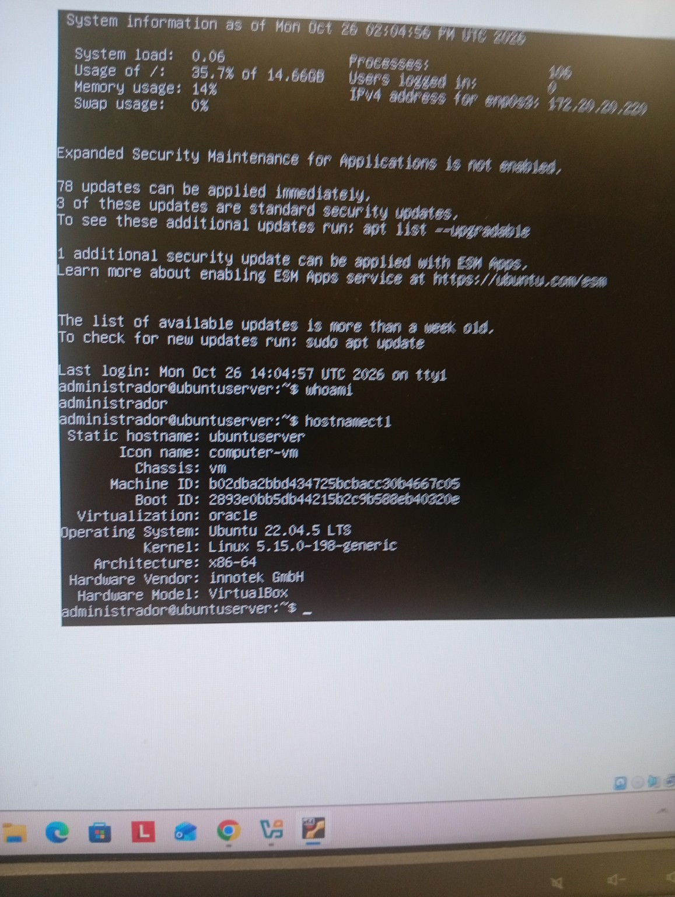
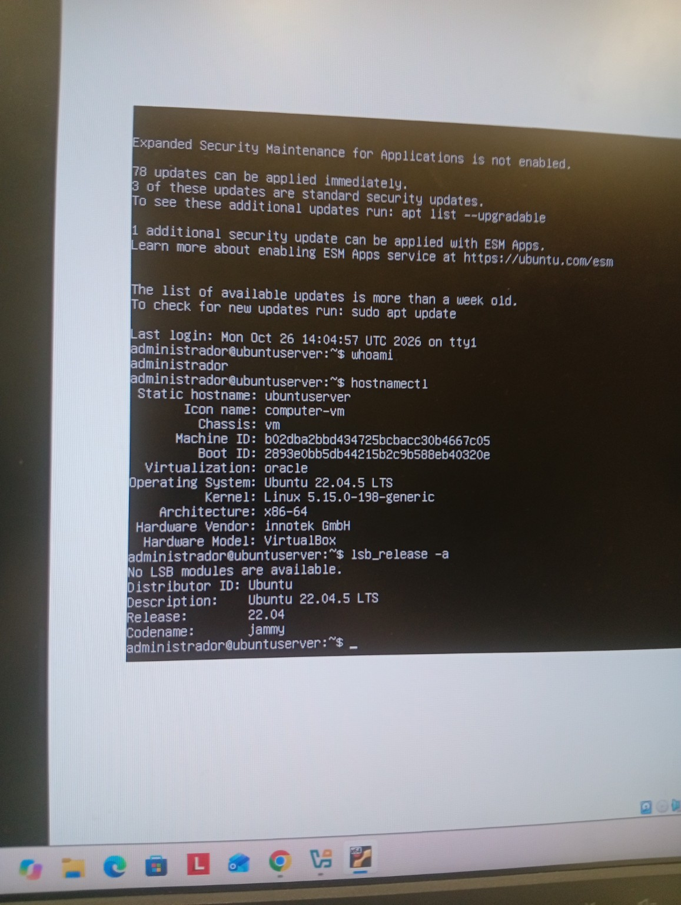
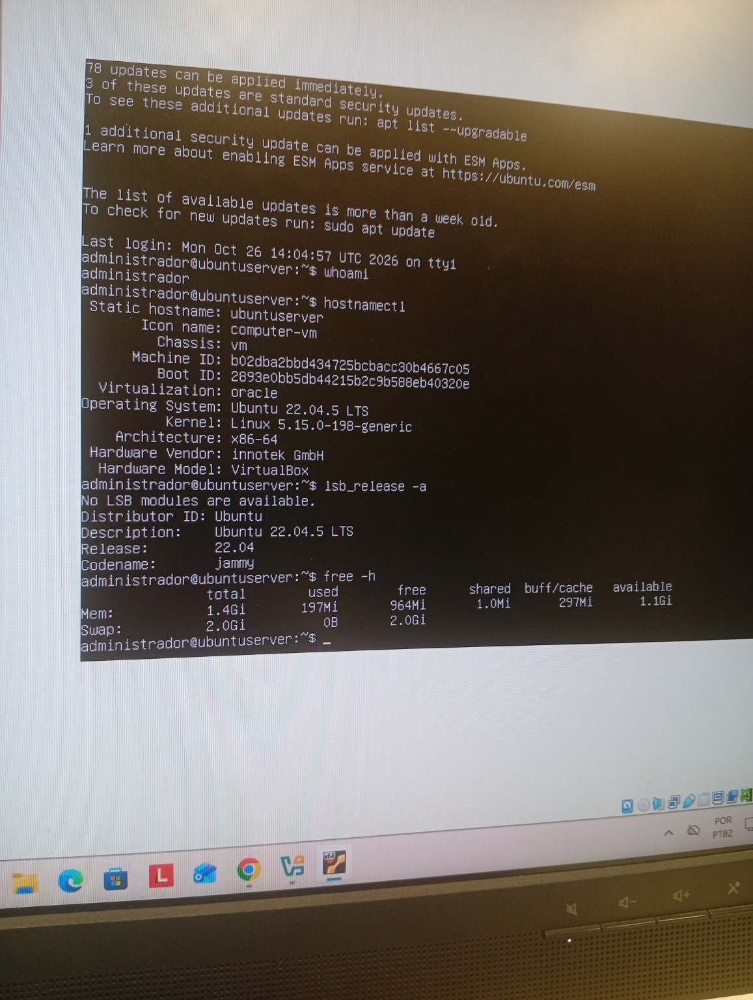
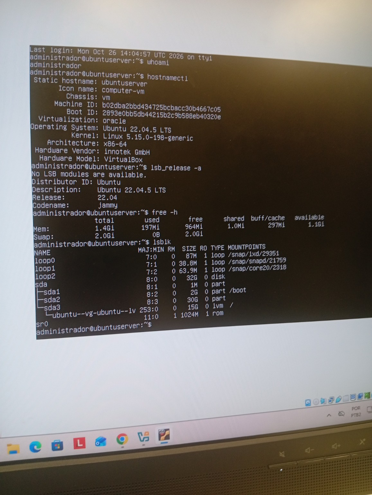
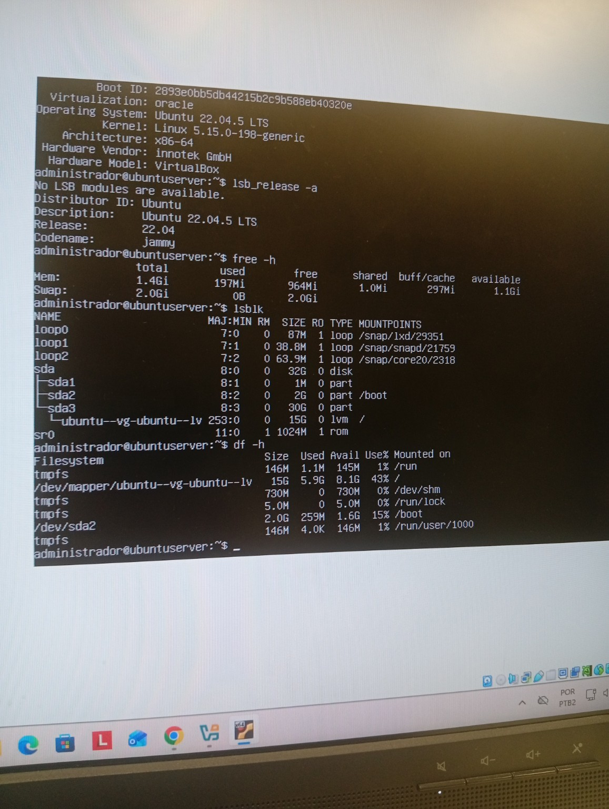
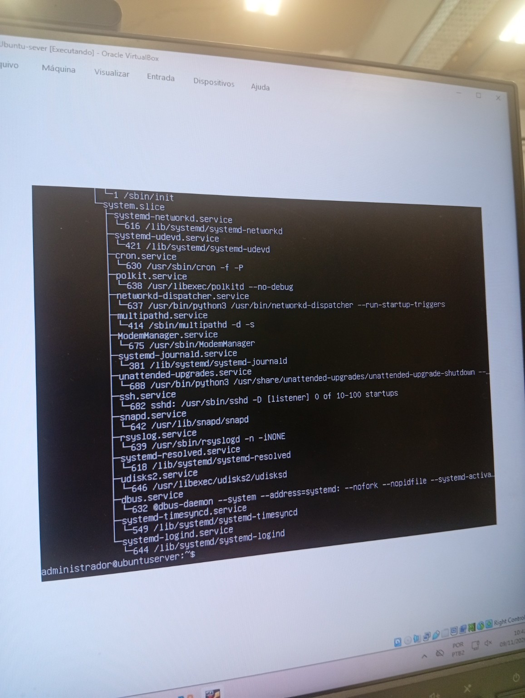
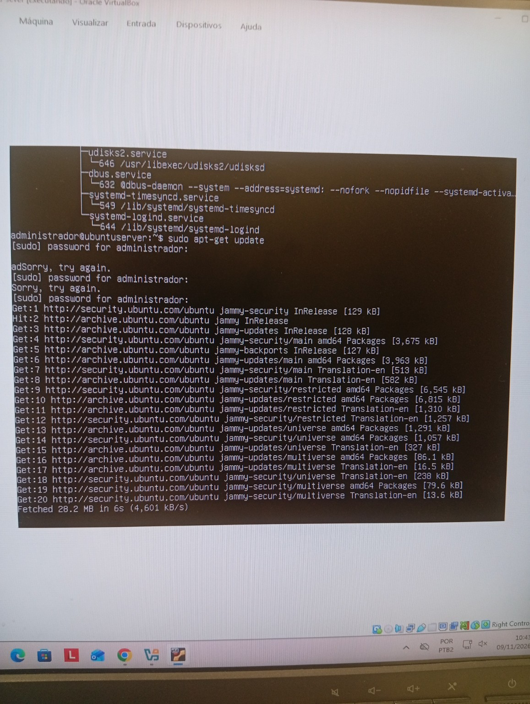
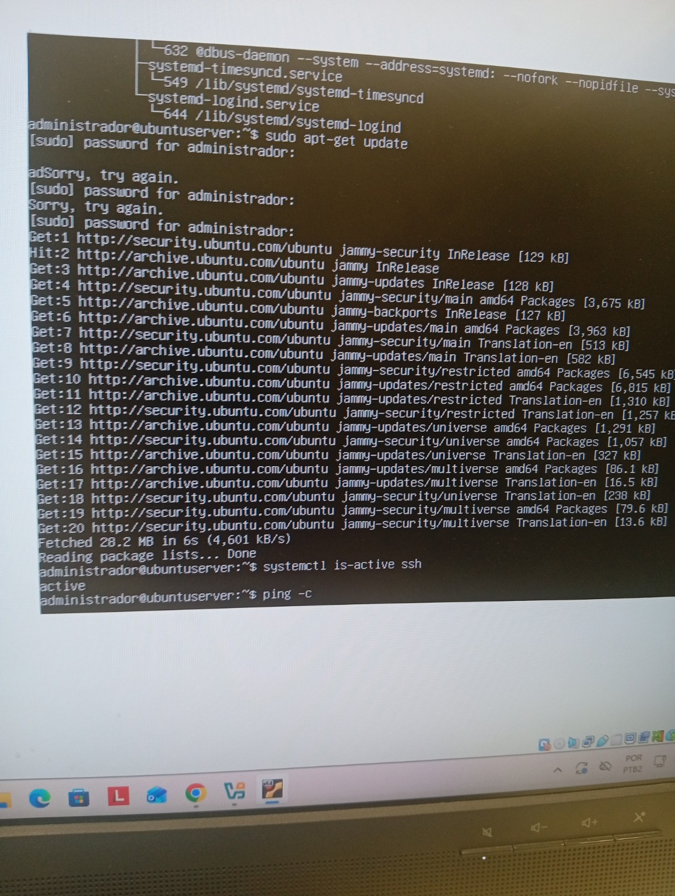
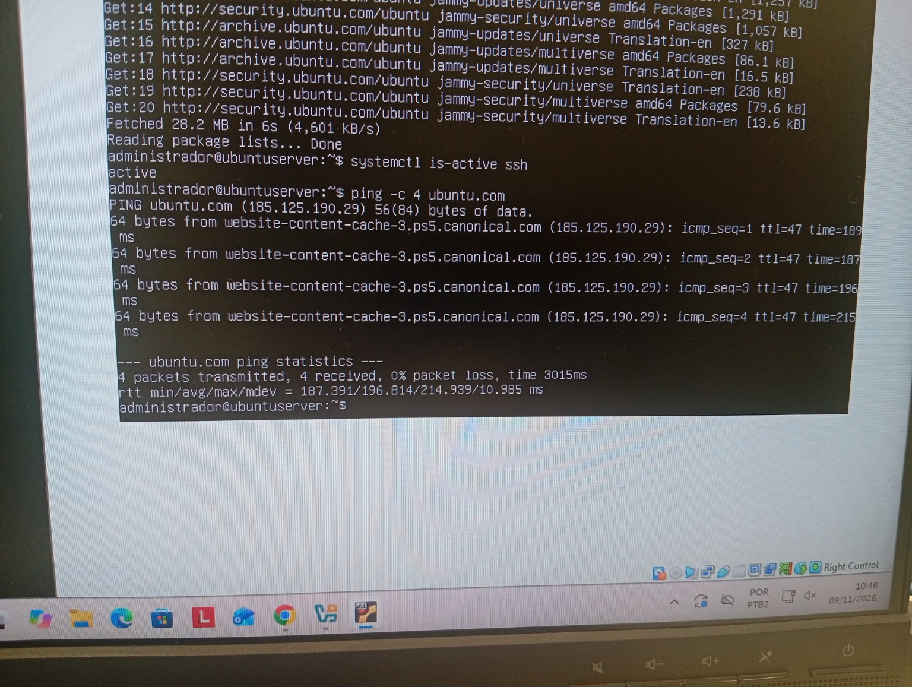

# Aula 1 — Instalação e configuração básica do Ubuntu Server

## Identificação

- **Aluno:** Elioenai Adalberto Silva Santos
- **Instituição:** IFAL — Campus Maceió
- **Curso:** Técnico em Desenvolvimento de Sistemas
- **Disciplina:** Laboratório de Sistemas Operacionais e Redes (LSOR)
- **Ambiente:** Oracle VirtualBox em computador com Windows

## Objetivo

Documentar o ambiente Ubuntu Server em máquina virtual, identificar suas configurações e executar comandos básicos de administração, armazenamento e conectividade.

## Ambiente utilizado

| Item | Resultado observado |
|---|---|
| Sistema operacional | Ubuntu Server 22.04.5 LTS |
| Kernel | Linux 5.15.0-198-generic |
| Arquitetura | x86-64 |
| Usuário | administrador |
| Hostname | ubuntuserver |
| Virtualização | Oracle VirtualBox |
| Memória RAM | 1,4 GiB |
| SWAP | 2,0 GiB |
| Disco virtual | 32 GB |
| Particionamento | LVM |
| Interface de rede | enp0s3 |

## Registro da atividade

A máquina virtual já estava instalada e funcional no momento dos registros. A evidência de login está abaixo:



### 1. Identificação do usuário

Comando executado:

```bash
whoami
```

O usuário conectado é administrador.



### 2. Identificação do sistema

Comando executado:

```bash
hostnamectl
```

O hostname é ubuntuserver; o sistema é Ubuntu 22.04.5 LTS, arquitetura x86-64, executado no VirtualBox.


### 3. Versão da distribuição

Comando executado:

```bash
lsb_release -a
```

A distribuição identificada é Ubuntu 22.04.5 LTS, versão 22.04, codinome jammy.



### 4. Memória RAM e SWAP

Comando executado:

```bash
free -h
```

Foram identificados 1,4 GiB de RAM, 197 MiB em uso e 2,0 GiB de SWAP, sem uso no momento da verificação.



### 5. Discos e partições

Comando executado:

```bash
lsblk
```

O disco virtual sda possui 32 GB. A partição sda2 possui 2 GB e está montada em /boot; a sda3 possui 30 GB, contendo volume lógico LVM de 15 GB montado em /.



### 6. Espaço de armazenamento

Comando executado:

```bash
df -h
```

O volume raiz de 15 GB apresentava 5,9 GB utilizados, 8,1 GB disponíveis e 43% de utilização.



### 7. Processos do sistema

Comando executado:

```bash
systemd-cgls
```

A árvore de serviços e processos mostrou componentes como systemd-networkd, cron, ssh, rsyslog e systemd-resolved.



### 8. Atualização da lista de pacotes

Comando executado:

```bash
sudo apt-get update
```

Após a autenticação, a lista de pacotes foi atualizada. Foram obtidos 28,2 MB de dados. Esse comando atualiza os índices dos repositórios, mas não instala todas as atualizações.



### 9. Estado do serviço SSH

Comando executado:

```bash
systemctl is-active ssh
```

O resultado foi active, indicando que o serviço SSH estava ativo.



### 10. Teste de conectividade

Comando executado:

```bash
ping -c 4 ubuntu.com
```

Foram enviados quatro pacotes e recebidos quatro, com 0% de perda. O tempo médio de resposta foi 196,814 ms.



## Observações e dificuldades

Durante a atualização da lista de pacotes ocorreram duas tentativas de senha incorreta no `sudo`, seguidas de autenticação bem-sucedida. Em outro momento, foi digitado `ip sddr`, que retornou erro de objeto desconhecido. Esses registros não impediram a conclusão dos testes apresentados.

A máquina utilizada possui Ubuntu 22.04.5 LTS, `/boot` de 2 GB e volume lógico raiz de 15 GB. Essas são as configurações efetivamente observadas, e podem diferir das especificações da versão atual do roteiro do professor. Não foi documentada uma instalação limpa realizada nesta sessão.

## Conclusão

Os comandos permitiram identificar o sistema, usuário, memória, disco, volumes LVM e processos. A atualização dos índices de pacotes foi concluída; o SSH estava ativo; e o teste de conectividade com `ubuntu.com` apresentou 0% de perda de pacotes. As imagens registram os resultados efetivamente obtidos na máquina virtual.
