# Aula 4 — Acesso Remoto com SSH no Ubuntu Server

**Aluno:** Elioenai Adalberto Silva Santos  
**Instituição:** Instituto Federal de Alagoas — IFAL  
**Disciplina:** Laboratório de Sistemas Operacionais e Redes

## 1. Objetivo

Realizar procedimentos de configuração e diagnóstico do acesso remoto ao Ubuntu Server utilizando o protocolo SSH, o VirtualBox e ferramentas de rede.

## 2. Desenvolvimento das atividades

### 2.1. Preparação do ambiente

Foi utilizado o Ubuntu Server em uma máquina virtual, com o objetivo de realizar configurações e testes relacionados à comunicação de rede e ao acesso remoto.

**Evidências:**

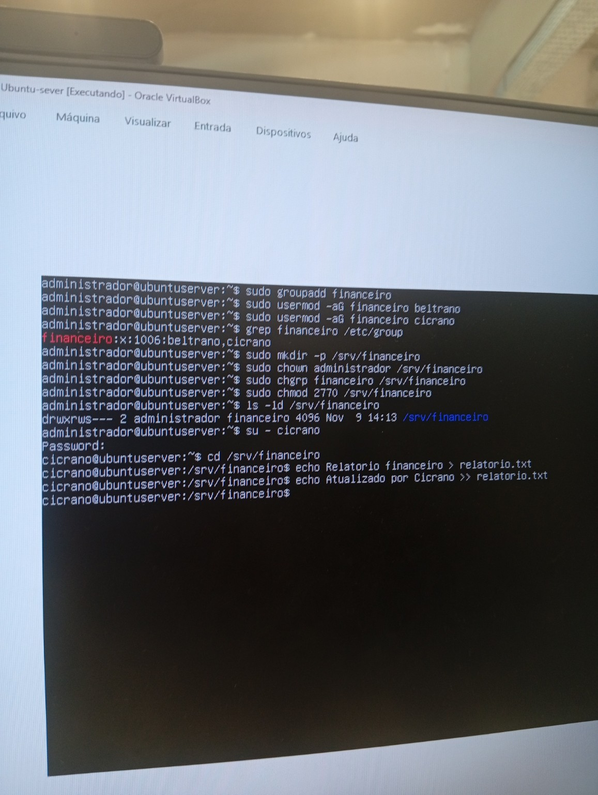

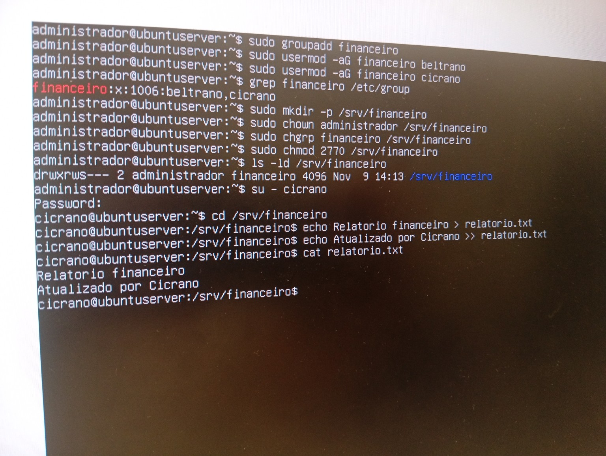

### 2.2. Verificação das configurações de rede

Foram executados comandos de diagnóstico para consultar as interfaces e configurações de rede do sistema.

Esses procedimentos são importantes para verificar a conectividade antes de tentar estabelecer uma conexão remota.

**Evidências:**

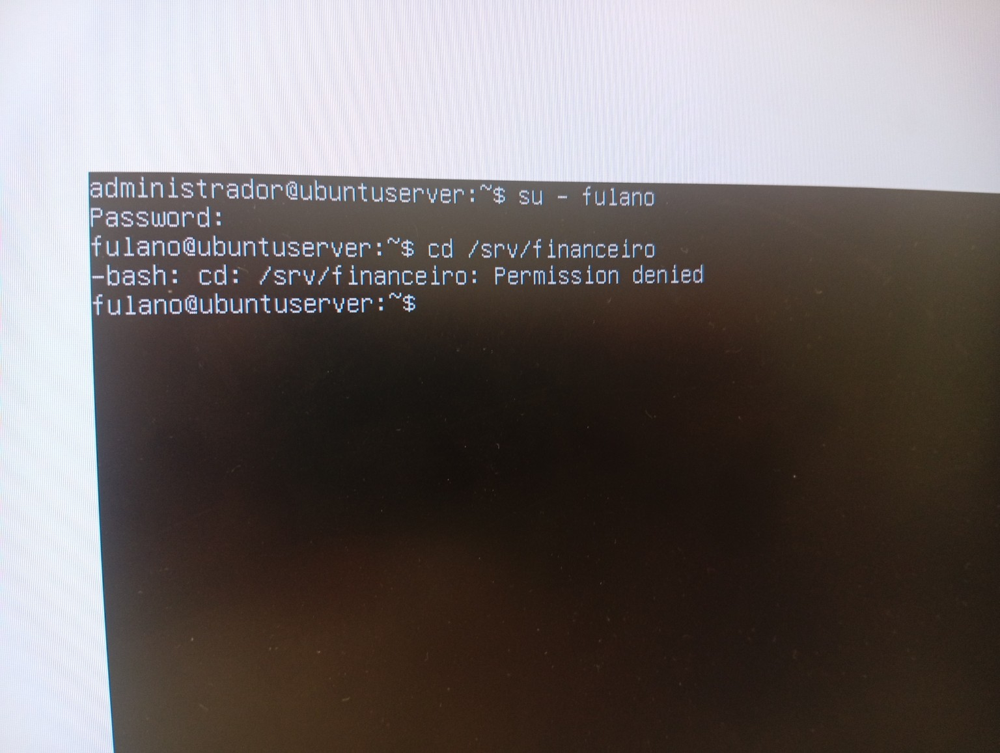

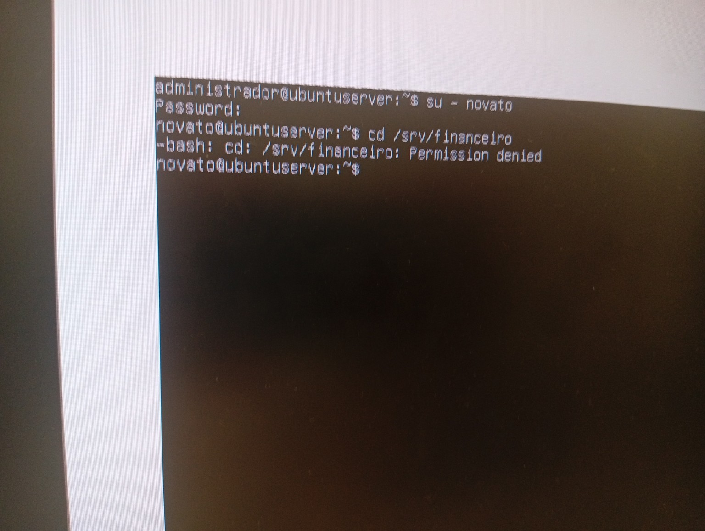

### 2.3. Verificação do Netplan

Foram realizados procedimentos relacionados à configuração de rede do Ubuntu Server por meio do Netplan.

O Netplan é utilizado para definir configurações de interfaces de rede em distribuições Ubuntu.

**Evidência:**

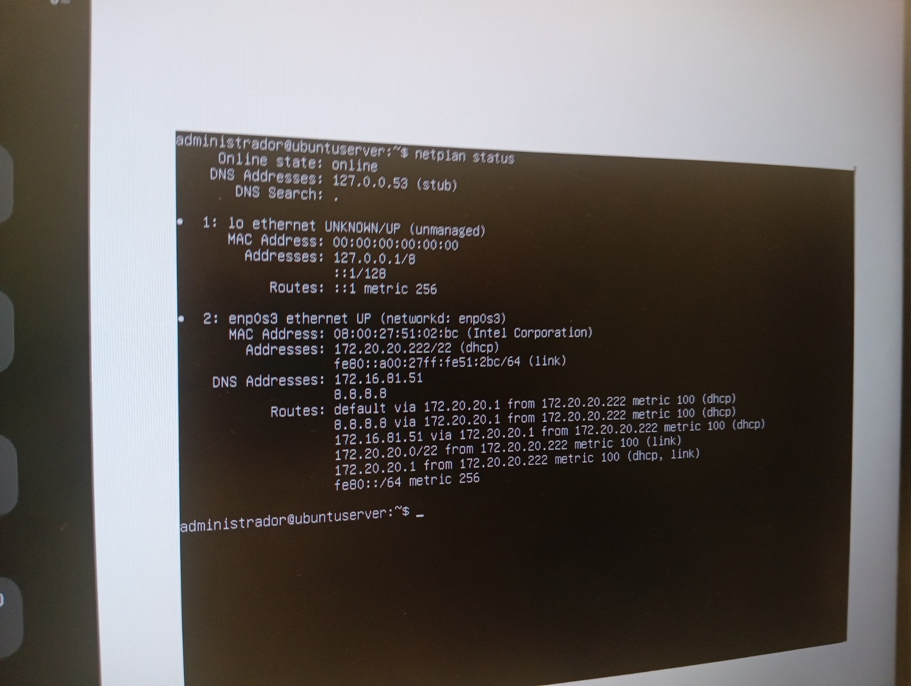

### 2.4. Verificação de pacotes e do serviço SSH

Foram realizados procedimentos de diagnóstico relacionados aos pacotes e ao serviço OpenSSH.

O SSH permite estabelecer conexões remotas criptografadas entre computadores.

**Evidências:**

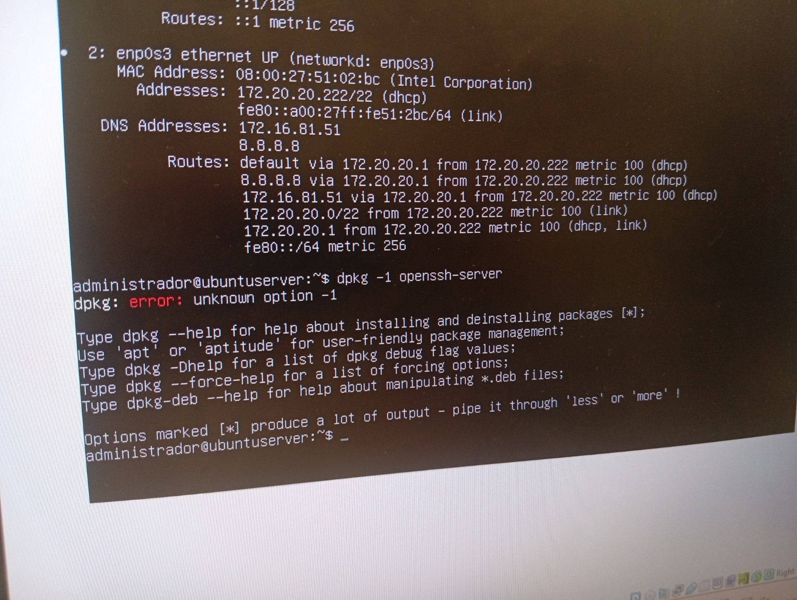

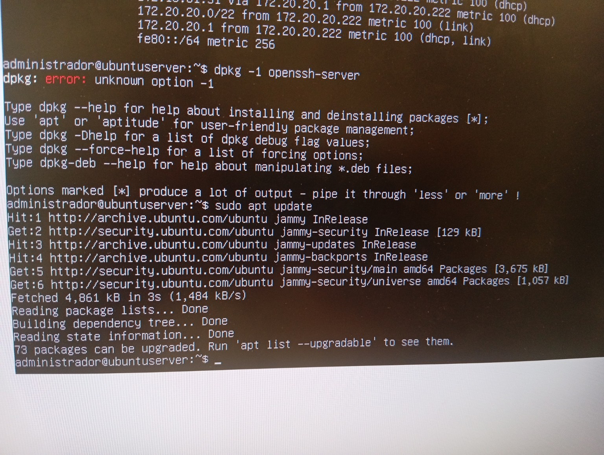

### 2.5. Configuração da máquina virtual

Foram verificados parâmetros da máquina virtual no VirtualBox, incluindo configurações relacionadas à rede.

Para realizar uma conexão SSH utilizando uma interface NAT do VirtualBox, pode ser necessário configurar uma regra de redirecionamento de portas.

Na atividade, foi trabalhada a utilização da porta `5222` no computador hospedeiro para encaminhamento à porta `22` do servidor virtual.

**Evidência:**

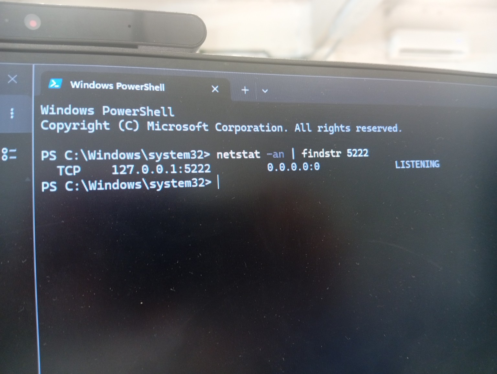

### 2.6. Testes no Windows

Foram realizados procedimentos de diagnóstico e tentativas de comunicação utilizando o Windows como sistema hospedeiro.

**Evidências:**

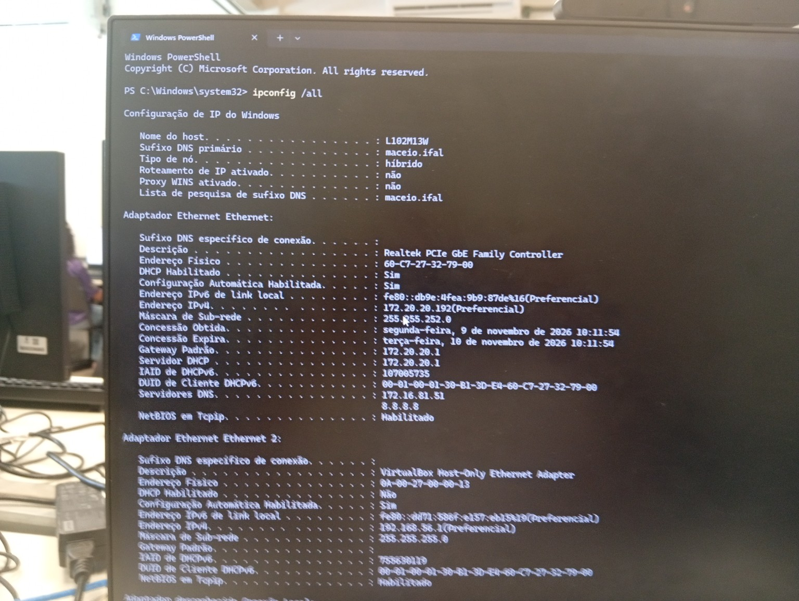

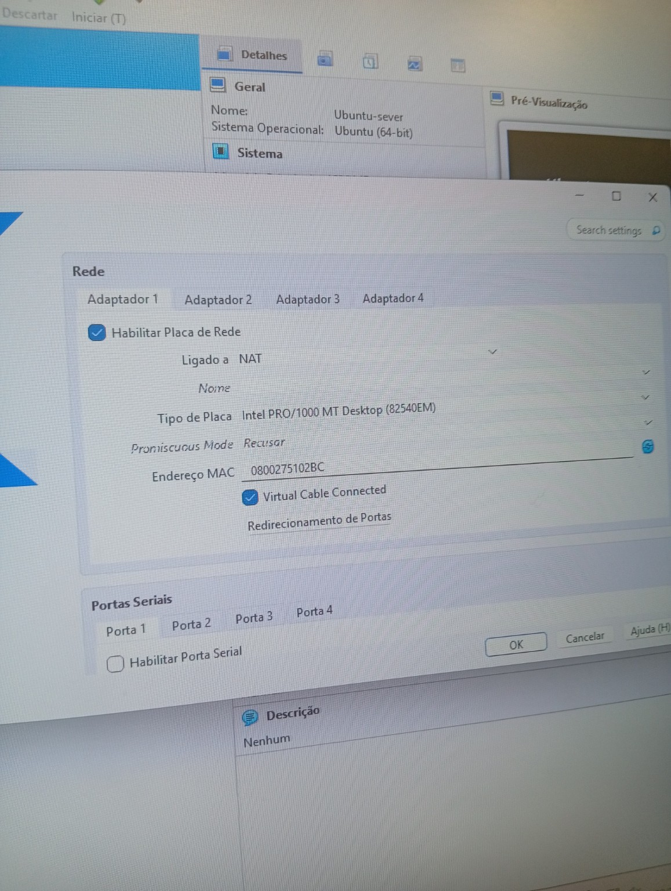

### 2.7. Tentativa de conexão SSH

Foi utilizada a seguinte estrutura de comando para tentar acessar remotamente o servidor:

```bash
ssh -p 5222 administrador@127.0.0.1
```

Nesse comando:

- `ssh`: inicia uma conexão remota.
- `-p 5222`: especifica a porta utilizada na conexão.
- `administrador`: identifica o usuário de acesso.
- `127.0.0.1`: representa o endereço de loopback do computador local.

Foram registradas tentativas de conexão e mensagens de erro durante os testes.

As evidências disponíveis não permitem confirmar que a conexão SSH pela porta `5222` tenha sido estabelecida com sucesso.

**Evidências:**

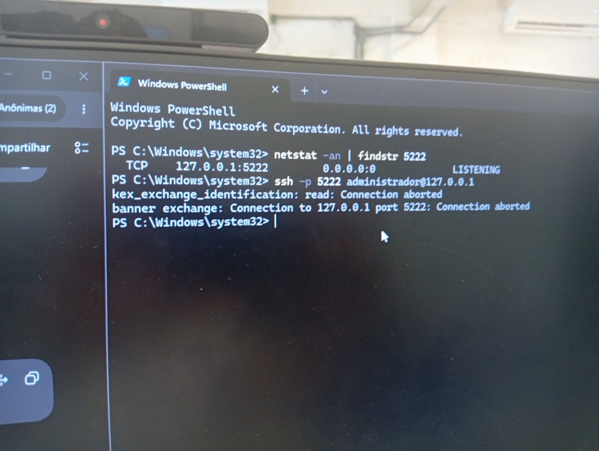

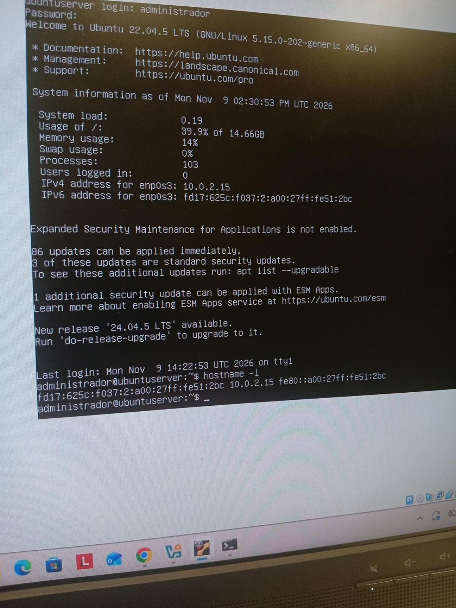

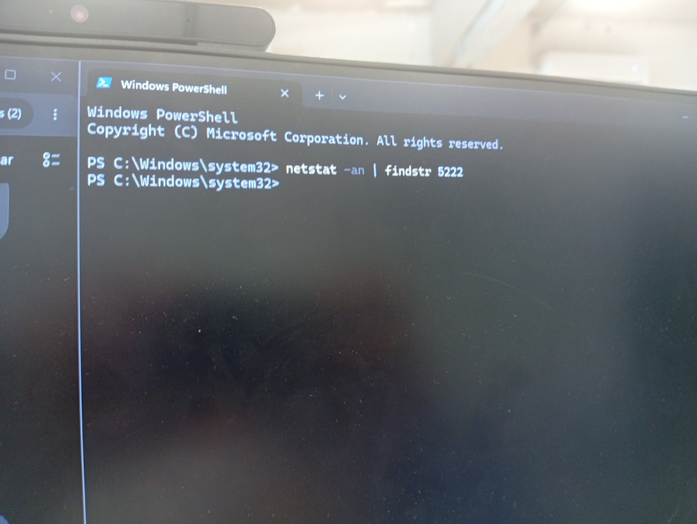

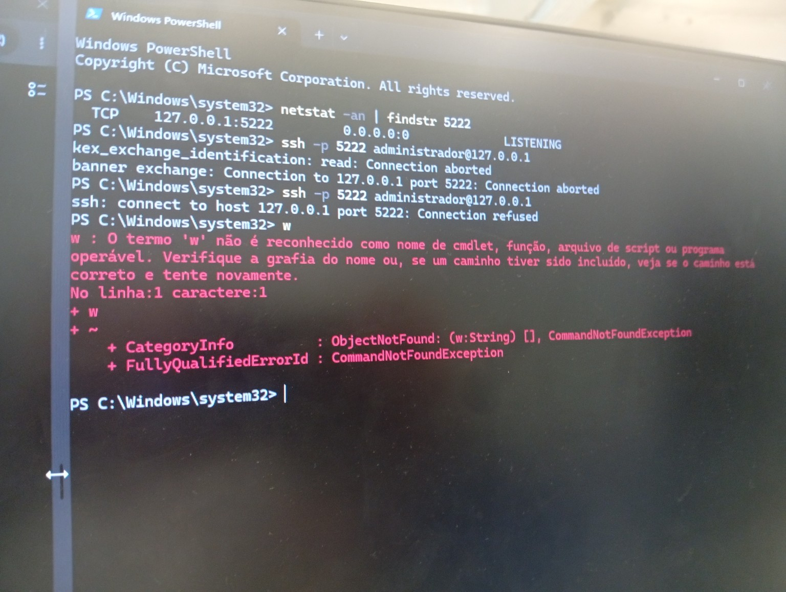

## 3. Resultados observados

A atividade possibilitou realizar diagnósticos da configuração de rede e praticar procedimentos relacionados ao SSH.

Durante os testes de conexão remota, foram encontradas dificuldades que impediram a confirmação do acesso SSH bem-sucedido nas evidências registradas.

Essas dificuldades demonstraram a importância de verificar as configurações de rede, o serviço SSH e o redirecionamento de portas.

## 4. Conclusão

A atividade contribuiu para a compreensão dos procedimentos necessários ao acesso remoto de servidores Linux.

Foram praticados comandos de diagnóstico de rede, verificação do OpenSSH, configurações do VirtualBox e tentativas de conexão remota.

Mesmo com dificuldades nos testes de conexão, a prática permitiu identificar etapas importantes para o diagnóstico e a configuração de serviços de rede.
